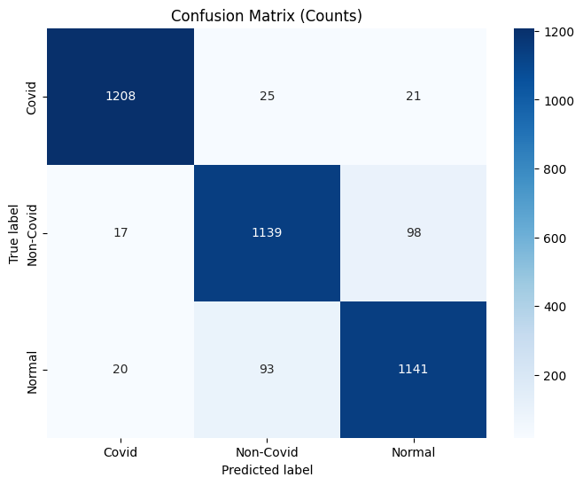
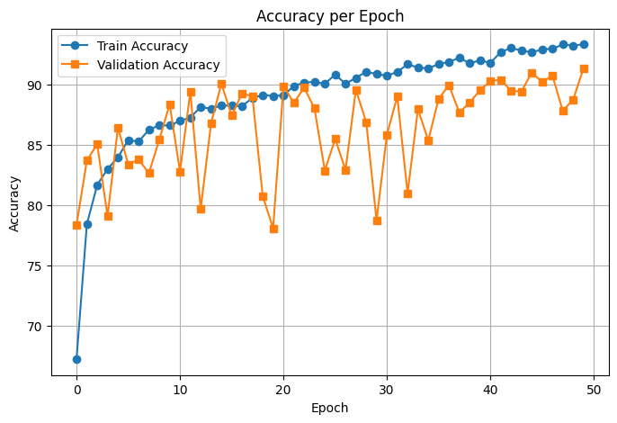

# Phân loại ảnh X-quang phổi COVID-19 bằng CNN tự thiết kế (CNN22)

[](https://colab.research.google.com/github/lechihung252/covid-xray-cnn22/blob/main/CNN22_COVID_Xray_Classification.ipynb)

Đồ án môn học: xây dựng và huấn luyện từ đầu một mạng CNN (PyTorch) để phân loại ảnh X-quang ngực thành 3 lớp: **Covid**, **Non-Covid** (viêm phổi khác) và **Normal**.

## Kết quả

| Tập | Accuracy | Loss |
|-----|----------|------|
| Validation (epoch 50) | 91.37% | 0.2396 |
| **Test** | **92.72%** | **0.2033** |

| Lớp | Precision | Recall | F1-score | Số ảnh |
|-----|-----------|--------|----------|--------|
| Covid | 0.97 | 0.96 | 0.97 | 1254 |
| Non-Covid | 0.91 | 0.91 | 0.91 | 1254 |
| Normal | 0.91 | 0.91 | 0.91 | 1254 |

<p float="left">
  
  
</p>

Mô hình nhận diện lớp **Covid** rất tốt (F1 = 0.97); phần lớn nhầm lẫn nằm giữa **Non-Covid** và **Normal**.

## Dữ liệu

| Tập | Số ảnh |
|-----|--------|
| Train | 9,783 |
| Validation | 1,506 |
| Test | 3,762 (cân bằng, 1,254 ảnh/lớp) |

Dataset được tổ chức theo cấu trúc `ImageFolder`:

```
Dataset2/
├── Train/{Covid, Non-Covid, Normal}/
├── Val/{Covid, Non-Covid, Normal}/
└── Test/{Covid, Non-Covid, Normal}/
```

> Dữ liệu không được đưa lên repo do dung lượng lớn.

## Phương pháp

**Tiền xử lý**
- Chuyển ảnh xám (1 kênh), resize 256×256
- **CLAHE** (clip limit 2.0, tile 8×8) để tăng tương phản cục bộ trên ảnh X-quang
- **Chuẩn hóa Z-score theo từng ảnh** (per-image standardization)
- Augmentation cho tập train: xoay ±15°, dịch chuyển 10%, thay đổi độ sáng

**Kiến trúc CNN22** (tự thiết kế)
- 9 khối `Conv2d 3×3 → BatchNorm → LeakyReLU(0.1)`, 8 khối đầu có `MaxPool 2×2`
- Số kênh: 64 → 128 → 64 → 128 → 256 → 128 → 256 → 128 → 256
- Classifier: `Flatten → Linear(256, 512) → LeakyReLU → Linear(512, 3)`

**Huấn luyện**
- Optimizer Adam, lr = 5e-5, loss CrossEntropy
- Batch size 32, 50 epochs, seed 252
- GPU T4 trên Google Colab (~74 phút)

## Chạy lại

1. Mở notebook bằng nút **Open in Colab** ở trên.
2. Đặt file `Dataset2.zip` vào `MyDrive/DA/` trên Google Drive (hoặc sửa đường dẫn trong cell giải nén).
3. Chọn runtime GPU và chạy toàn bộ notebook.

Chạy local: `pip install -r requirements.txt`, bỏ qua 2 cell đầu (mount Drive) và trỏ đường dẫn dataset tới thư mục của bạn.

## Công nghệ

Python · PyTorch · torchvision · OpenCV · scikit-learn · Matplotlib · Seaborn · Google Colab
