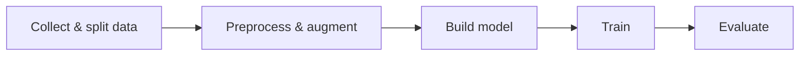

# COVID-19 Detection from Chest X-rays with CNNs

**English** | [Tiếng Việt](README.vi.md)

A PyTorch project that classifies chest X-ray images into **COVID-19**, **Non-COVID** (other lung infections) and **Normal**, comparing a baseline CNN, the same CNN with data augmentation, and a deeper 22-layer CNN.

> Course project (Đồ án 2), Applied Mathematics & Informatics, Hanoi University of Science and Technology (HUST), January 2026.
> Author: **Lê Chí Hùng** · Supervisor: Dr. Lê Kim Thư

| Notebook | Model | Test accuracy | Open |
|---|---|---|---|
| [`01_CNN1_augmentation.ipynb`](notebooks/01_CNN1_augmentation.ipynb) | CNN1 + data augmentation | 91.73% | [](https://colab.research.google.com/github/lechihung252/covid-xray-cnn22/blob/main/notebooks/01_CNN1_augmentation.ipynb) |
| [`02_CNN22.ipynb`](notebooks/02_CNN22.ipynb) | CNN22 (final model) | **92.72%** | [](https://colab.research.google.com/github/lechihung252/covid-xray-cnn22/blob/main/notebooks/02_CNN22.ipynb) |

## Motivation

RT-PCR is the reference test for COVID-19, but its sensitivity is only about 60–70% and results take hours. Chest X-rays are cheap, fast and widely available, yet hard to read: COVID-19 and other pneumonias look alike. This project tests whether a CNN can act as a fast **screening aid** that separates the three groups. It is meant to support RT-PCR, not replace it.

## Dataset

Images come from **[COVID-QU-Ex](https://doi.org/10.34740/kaggle/dsv/3122898)** (Qatar University & University of Dhaka, 2021). The full dataset has 33,920 chest X-rays (256×256 PNG) from hospitals in Europe, North America and Asia. COVID-19 images were collected in 2020–2021; Normal and Non-COVID images come from pre-pandemic archives (1992–2017), so the control groups cannot contain hidden COVID cases.

A **balanced subset of 15,051 images** (5,017 per class) was sampled at random to avoid class imbalance:

| Split | Ratio | Images |
|---|---|---|
| Train | 65% | 9,783 |
| Validation | 10% | 1,506 |
| Test | 25% | 3,762 (1,254 per class) |

The data is not included in this repository. Expected layout (`torchvision.datasets.ImageFolder`):

```
Dataset2/
├── Train/{Covid, Non-Covid, Normal}/
├── Val/{Covid, Non-Covid, Normal}/
└── Test/{Covid, Non-Covid, Normal}/
```

## Pipeline



**Preprocessing** (every image)
1. Convert to grayscale (1 channel), which cuts input memory by about 2/3
2. **CLAHE** (clip limit 2.0, 8×8 tiles) to raise local contrast in lung regions
3. Resize to 256×256
4. **Per-image z-score standardization**


**Augmentation** (training set only, experiments 2 and 3): random rotation ±15°, translation up to 10%, brightness jitter ±20%.

## Models

| | CNN1 | CNN22 |
|---|---|---|
| Based on | Randieri et al., 2025 | CoroDet, Hussain et al., 2021 |
| Conv layers | 5 (64→128 filters) | 9 (64→256 filters) |
| BatchNorm | – | after every conv |
| Activation | LeakyReLU (0.01) | LeakyReLU (0.1) |
| Max-pooling | 4 | 8 |
| Classifier | Flatten → Dropout(0.4) → Dense(512) → Dense(3) | Flatten → Dense(512) → Dense(3) |
| Parameters | ~17.1 M | ~1.8 M |

Both models were re-implemented in PyTorch. CNN22 pools down to a 1×1×256 feature map, so its classifier is tiny. As a result it has **about 9× fewer parameters** than CNN1, which spends most of its weights on a 32,768→512 dense layer.

**Training setup:** Adam (lr = 5e-5), cross-entropy loss, batch size 32, seed 252, NVIDIA T4 GPU on Google Colab. CNN1 + augmentation was trained for 70 epochs (~72 s/epoch) and CNN22 for 50 epochs (~88 s/epoch).

## Results

Three experiments on the same test set:

| Metric | CNN1 baseline | CNN1 + augmentation | **CNN22** |
|---|---|---|---|
| Accuracy | 0.88 | 0.92 | **0.93** |
| F1 – COVID | 0.94 | 0.95 | **0.97** |
| F1 – Non-COVID | 0.84 | 0.90 | **0.91** |
| F1 – Normal | 0.85 | 0.90 | **0.91** |
| Misclassified test images | 451 | 311 | **274** |
| Non-COVID predicted as Normal | 195 | 101 | **98** |
| Training time (s/epoch) | – | 72 | 88 |

<sub>The CNN1 baseline (no augmentation) results come from the project report; that notebook is not included.</sub>

**Final model (CNN22) per-class report**

| Class | Precision | Recall | F1 |
|---|---|---|---|
| COVID | 0.97 | 0.96 | 0.97 |
| Non-COVID | 0.91 | 0.91 | 0.91 |
| Normal | 0.91 | 0.91 | 0.91 |

**Confusion matrices:** CNN1 baseline → CNN1 + augmentation → CNN22

<p float="left">
  
  
  
</p>

**Training curves:** CNN1 + augmentation (left), CNN22 (right)

<p float="left">
  
  
</p>

## Analysis

- **COVID-19 is the easiest class.** All three models reach F1 ≥ 0.94 on it. CNN22 correctly identifies 1,208 of 1,254 COVID cases (96.3%) with 0.97 precision.
- **The hard boundary is Non-COVID vs. Normal.** In the baseline, 195 Non-COVID images were predicted as Normal.
- **Augmentation gives the biggest gain for its cost.** It raises accuracy from 0.88 to 0.92 and nearly halves the Non-COVID→Normal errors (195 → 101), with no extra inference cost.
- **The deeper architecture adds a smaller, more balanced gain.** CNN22 reaches 0.93 accuracy, and its Non-COVID↔Normal confusions become symmetric (98 vs. 93), so the model no longer leans toward one class. Training takes about 22% longer per epoch.
- **Sample-level error analysis:** comparing models image by image shows that aggregate accuracy hides churn.
  - Augmentation kept 179 of the baseline's errors and introduced 132 new ones, spread across all three classes.
  - CNN22 fixed 156 of the augmented model's 311 errors but introduced 119 new ones, mostly in Non-COVID (53) and Normal (46).
  - Each change moves the decision boundary rather than only improving on the previous model.

## Limitations & future work

- Only trained from scratch. Next steps are transfer learning with ResNet, DenseNet or EfficientNet, and a comparison against these backbones.
- Grad-CAM heatmaps, to check that the model looks at the lungs and not at scanner artifacts.
- GAN-based augmentation for the Non-COVID / Normal boundary.
- Multimodal input (age, symptoms, clinical history).
- A web or mobile demo for real-time inference.

> ⚠️ **Disclaimer:** this is an academic project and is **not** a medical device. It must not be used for clinical diagnosis.

## How to run

1. Click an **Open in Colab** badge above and select a GPU runtime.
2. Put `Dataset2.zip` (structured as shown above) in `MyDrive/DA/` on Google Drive, or edit the path in the unzip cell.
3. Run all cells.

To run locally, install the dependencies with `pip install -r requirements.txt`, skip the two Google Drive cells, and point the `ImageFolder` paths to your dataset folder.

## Tech stack

Python · PyTorch · torchvision · OpenCV · scikit-learn · Matplotlib · Seaborn · Google Colab

## References

- Dataset: A. M. Tahir et al., *COVID-QU-Ex*, Kaggle, 2021. doi:10.34740/kaggle/dsv/3122898
- A. M. Tahir et al., "COVID-19 Infection Localization and Severity Grading from Chest X-ray Images", *Computers in Biology and Medicine*, 139, 2021.
- E. Hussain et al., "CoroDet: A deep learning based classification for COVID-19 detection using chest X-ray images", *Chaos, Solitons & Fractals*, 142, 2021.
- C. Randieri et al., "CNN-Based Framework for Classifying COVID-19, Pneumonia, and Normal Chest X-Rays", *Big Data and Cognitive Computing*, 9(7), 2025.
