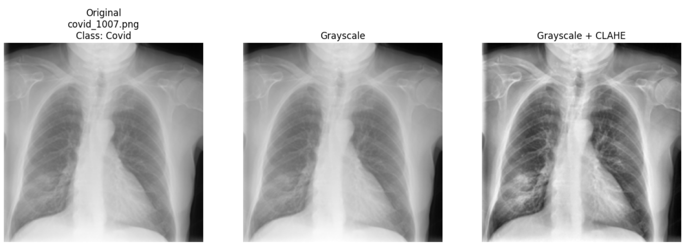
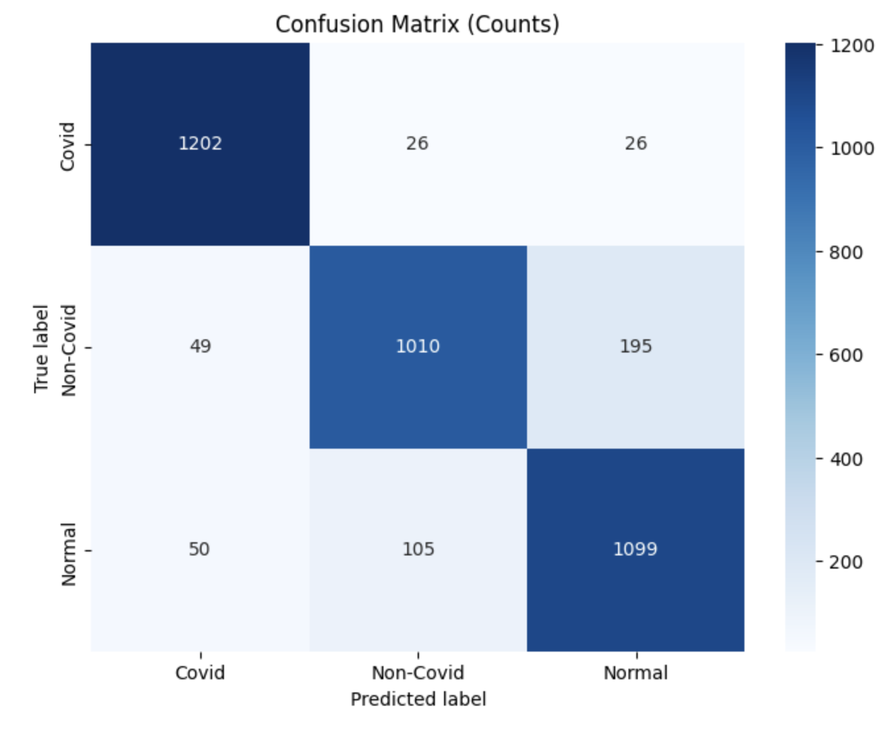
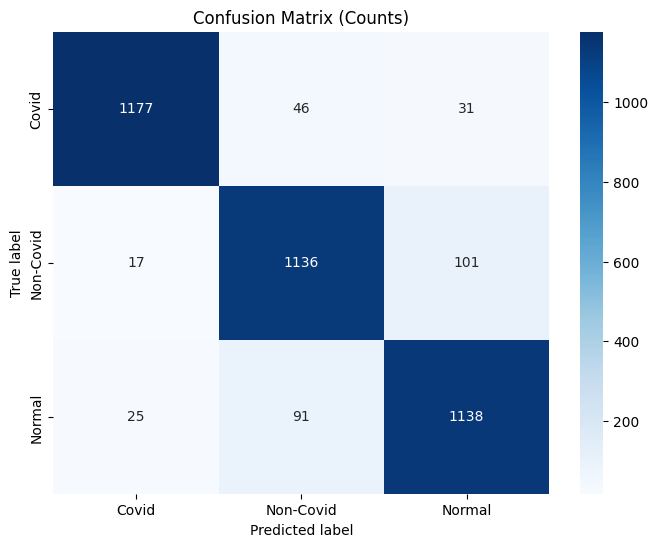
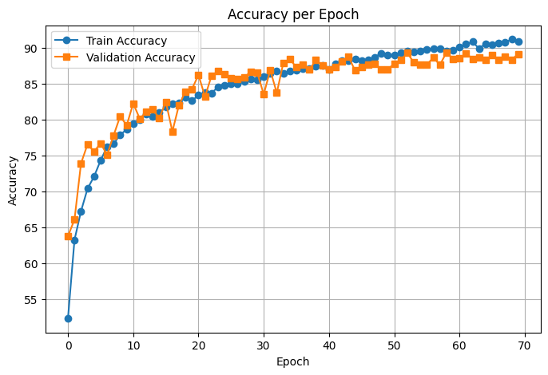

# Phát hiện COVID-19 từ ảnh X-quang phổi bằng CNN

[English](README.md) | **Tiếng Việt**

Dự án dùng PyTorch để phân loại ảnh X-quang ngực thành 3 lớp: **COVID-19**, **Non-COVID** (các bệnh nhiễm trùng phổi khác) và **Normal**. Dự án so sánh 3 thí nghiệm: một CNN cơ sở, chính CNN đó khi có thêm tăng cường dữ liệu, và một mạng CNN 22 lớp sâu hơn.

> Đồ án 2, chuyên ngành Toán Tin, Đại học Bách khoa Hà Nội (HUST), tháng 1/2026.
> Sinh viên thực hiện: **Lê Chí Hùng** · Giảng viên hướng dẫn: TS. Lê Kim Thư

| Notebook | Mô hình | Accuracy (test) | Mở |
|---|---|---|---|
| [`01_CNN1_augmentation.ipynb`](notebooks/01_CNN1_augmentation.ipynb) | CNN1 + tăng cường dữ liệu | 91.73% | [](https://colab.research.google.com/github/lechihung252/covid-xray-cnn22/blob/main/notebooks/01_CNN1_augmentation.ipynb) |
| [`02_CNN22.ipynb`](notebooks/02_CNN22.ipynb) | CNN22 (mô hình cuối) | **92.72%** | [](https://colab.research.google.com/github/lechihung252/covid-xray-cnn22/blob/main/notebooks/02_CNN22.ipynb) |

## Bối cảnh

RT-PCR là xét nghiệm tiêu chuẩn để chẩn đoán COVID-19, nhưng độ nhạy chỉ khoảng 60–70% và phải chờ nhiều giờ mới có kết quả. Chụp X-quang phổi rẻ, nhanh và phổ biến, nhưng khó đọc vì tổn thương do COVID-19 và do các loại viêm phổi khác trông khá giống nhau. Dự án kiểm tra xem CNN có thể làm **công cụ sàng lọc nhanh** để phân biệt 3 nhóm này hay không. Mục tiêu là hỗ trợ RT-PCR chứ không thay thế nó.

## Dữ liệu

Ảnh được lấy từ bộ **[COVID-QU-Ex](https://doi.org/10.34740/kaggle/dsv/3122898)** do Đại học Qatar và Đại học Dhaka công bố năm 2021. Bộ gốc có 33.920 ảnh X-quang ngực (PNG, 256×256), thu thập từ các bệnh viện ở châu Âu, Bắc Mỹ và châu Á. Ảnh COVID-19 được chụp trong giai đoạn 2020–2021. Ảnh Normal và Non-COVID lấy từ các kho dữ liệu trước đại dịch (1992–2017), nên nhóm đối chứng chắc chắn không lẫn ca COVID.

Đồ án lấy ngẫu nhiên một **tập con cân bằng gồm 15.051 ảnh** (5.017 ảnh mỗi lớp) để tránh mất cân bằng lớp:

| Tập | Tỉ lệ | Số ảnh |
|---|---|---|
| Train | 65% | 9.783 |
| Validation | 10% | 1.506 |
| Test | 25% | 3.762 (1.254 ảnh/lớp) |

Dữ liệu không được đưa lên repo. Cấu trúc thư mục theo `torchvision.datasets.ImageFolder`:

```
Dataset2/
├── Train/{Covid, Non-Covid, Normal}/
├── Val/{Covid, Non-Covid, Normal}/
└── Test/{Covid, Non-Covid, Normal}/
```

## Quy trình


**Tiền xử lý** (áp dụng cho mọi ảnh)
1. Chuyển sang ảnh xám 1 kênh, giảm khoảng 2/3 bộ nhớ ở đầu vào
2. **CLAHE** (clip limit 2.0, lưới 8×8) để tăng tương phản cục bộ ở vùng phổi
3. Resize về 256×256
4. **Chuẩn hóa z-score theo từng ảnh**



**Tăng cường dữ liệu** (chỉ áp dụng cho tập train ở thí nghiệm 2 và 3): xoay ngẫu nhiên ±15°, dịch chuyển tối đa 10%, thay đổi độ sáng ±20%.

## Mô hình

| | CNN1 | CNN22 |
|---|---|---|
| Dựa trên | Randieri et al., 2025 | CoroDet, Hussain et al., 2021 |
| Số lớp tích chập | 5 (64→128 bộ lọc) | 9 (64→256 bộ lọc) |
| BatchNorm | – | sau mỗi lớp tích chập |
| Hàm kích hoạt | LeakyReLU (0.01) | LeakyReLU (0.1) |
| Max-pooling | 4 | 8 |
| Khối phân loại | Flatten → Dropout(0.4) → Dense(512) → Dense(3) | Flatten → Dense(512) → Dense(3) |
| Số tham số | ~17,1 triệu | ~1,8 triệu |

Cả hai mô hình được cài đặt lại bằng PyTorch. CNN22 giảm feature map xuống còn 1×1×256 nên khối phân loại rất nhỏ. Nhờ đó nó có **ít tham số hơn CNN1 khoảng 9 lần**. Phần lớn tham số của CNN1 nằm ở lớp Dense 32.768→512.

**Thiết lập huấn luyện:** Adam (lr = 5e-5), hàm mất mát cross-entropy, batch size 32, seed 252, GPU NVIDIA T4 trên Google Colab. CNN1 + tăng cường được train 70 epoch (~72 s/epoch), CNN22 được train 50 epoch (~88 s/epoch).

## Kết quả

Ba thí nghiệm được đánh giá trên cùng một tập test:

| Chỉ số | CNN1 cơ sở | CNN1 + tăng cường | **CNN22** |
|---|---|---|---|
| Accuracy | 0.88 | 0.92 | **0.93** |
| F1 – COVID | 0.94 | 0.95 | **0.97** |
| F1 – Non-COVID | 0.84 | 0.90 | **0.91** |
| F1 – Normal | 0.85 | 0.90 | **0.91** |
| Số ảnh test bị dự đoán sai | 451 | 311 | **274** |
| Non-COVID bị đoán thành Normal | 195 | 101 | **98** |
| Thời gian huấn luyện (s/epoch) | – | 72 | 88 |

<sub>Kết quả của CNN1 cơ sở (không tăng cường) lấy từ báo cáo đồ án; notebook của thí nghiệm này không được đưa lên repo.</sub>

**Báo cáo theo từng lớp của mô hình cuối (CNN22)**

| Lớp | Precision | Recall | F1 |
|---|---|---|---|
| COVID | 0.97 | 0.96 | 0.97 |
| Non-COVID | 0.91 | 0.91 | 0.91 |
| Normal | 0.91 | 0.91 | 0.91 |

**Ma trận nhầm lẫn:** CNN1 cơ sở → CNN1 + tăng cường → CNN22

<p float="left">
  
  
  
</p>

**Đường cong accuracy:** CNN1 + tăng cường (trái), CNN22 (phải)

<p float="left">
  
  
</p>

## Phân tích

- **COVID-19 là lớp dễ nhận diện nhất.** Cả 3 mô hình đều đạt F1 ≥ 0.94 ở lớp này. CNN22 nhận diện đúng 1.208/1.254 ca COVID (96,3%), với precision 0.97.
- **Khó nhất là phân biệt Non-COVID với Normal.** Ở mô hình cơ sở, có 195 ảnh Non-COVID bị đoán thành Normal.
- **Tăng cường dữ liệu mang lại hiệu quả lớn nhất so với chi phí.** Accuracy tăng từ 0.88 lên 0.92, số ca Non-COVID bị đoán thành Normal giảm gần một nửa (195 → 101), và thời gian suy luận không tăng.
- **Kiến trúc sâu hơn cải thiện thêm một chút và cân bằng hơn.** CNN22 đạt accuracy 0.93. Số ca nhầm giữa Non-COVID và Normal theo hai chiều gần như bằng nhau (98 và 93), tức là mô hình không còn thiên về một lớp. Đổi lại, mỗi epoch train lâu hơn khoảng 22%.
- **Phân tích lỗi trên từng mẫu:** so sánh dự đoán của các mô hình trên từng ảnh cho thấy accuracy tổng không phản ánh hết những thay đổi bên trong.
  - Mô hình có tăng cường vẫn mắc lại 179 lỗi của mô hình cơ sở và phát sinh 132 lỗi mới, rải đều ở cả 3 lớp.
  - CNN22 sửa được 156 trong 311 lỗi của mô hình có tăng cường, nhưng phát sinh 119 lỗi mới, chủ yếu ở Non-COVID (53) và Normal (46).
  - Mỗi thay đổi làm dịch chuyển ranh giới phân loại, chứ không chỉ đơn thuần cải thiện so với mô hình trước.

## Hạn chế và hướng phát triển

- Hiện các mô hình chỉ được train từ đầu. Bước tiếp theo là thử transfer learning với ResNet, DenseNet hoặc EfficientNet và so sánh với các backbone này.
- Dùng Grad-CAM để kiểm tra mô hình có thực sự nhìn vào vùng phổi hay đang dựa vào nhiễu từ máy chụp.
- Tăng cường dữ liệu bằng GAN để cải thiện ranh giới giữa Non-COVID và Normal.
- Kết hợp thêm dữ liệu lâm sàng (tuổi, triệu chứng, tiền sử bệnh).
- Xây dựng demo web hoặc mobile để chạy dự đoán theo thời gian thực.

> ⚠️ **Lưu ý:** đây là dự án học thuật, **không** phải thiết bị y tế và không được dùng để chẩn đoán lâm sàng.

## Cách chạy

1. Bấm nút **Open in Colab** ở trên và chọn runtime GPU.
2. Đặt file `Dataset2.zip` (đúng cấu trúc thư mục ở trên) vào `MyDrive/DA/` trên Google Drive, hoặc sửa đường dẫn trong cell giải nén.
3. Chạy toàn bộ notebook.

Để chạy trên máy cá nhân: cài thư viện bằng `pip install -r requirements.txt`, bỏ qua 2 cell Google Drive và trỏ đường dẫn `ImageFolder` tới thư mục dataset của bạn.

## Công nghệ

Python · PyTorch · torchvision · OpenCV · scikit-learn · Matplotlib · Seaborn · Google Colab

## Tài liệu tham khảo

- Dataset: A. M. Tahir et al., *COVID-QU-Ex*, Kaggle, 2021. doi:10.34740/kaggle/dsv/3122898
- A. M. Tahir et al., "COVID-19 Infection Localization and Severity Grading from Chest X-ray Images", *Computers in Biology and Medicine*, 139, 2021.
- E. Hussain et al., "CoroDet: A deep learning based classification for COVID-19 detection using chest X-ray images", *Chaos, Solitons & Fractals*, 142, 2021.
- C. Randieri et al., "CNN-Based Framework for Classifying COVID-19, Pneumonia, and Normal Chest X-Rays", *Big Data and Cognitive Computing*, 9(7), 2025.
